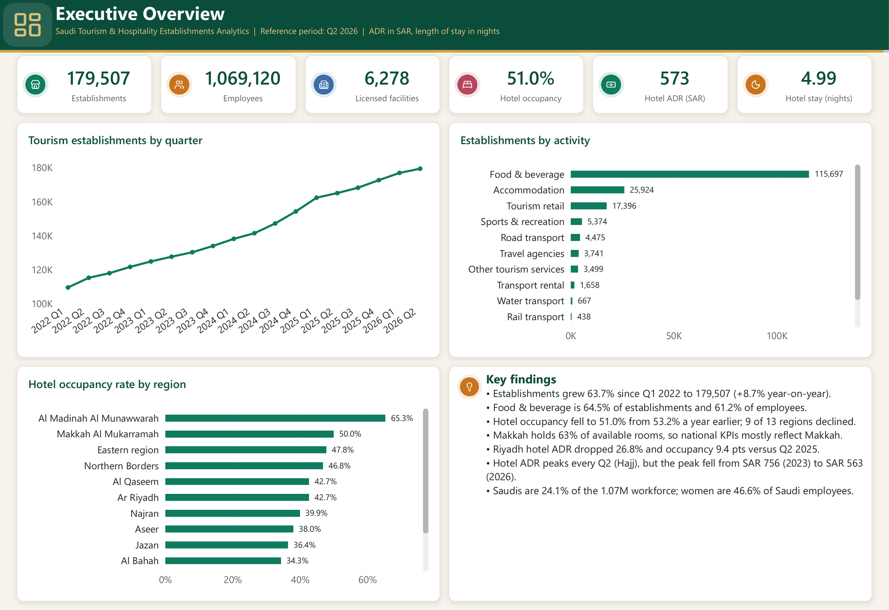
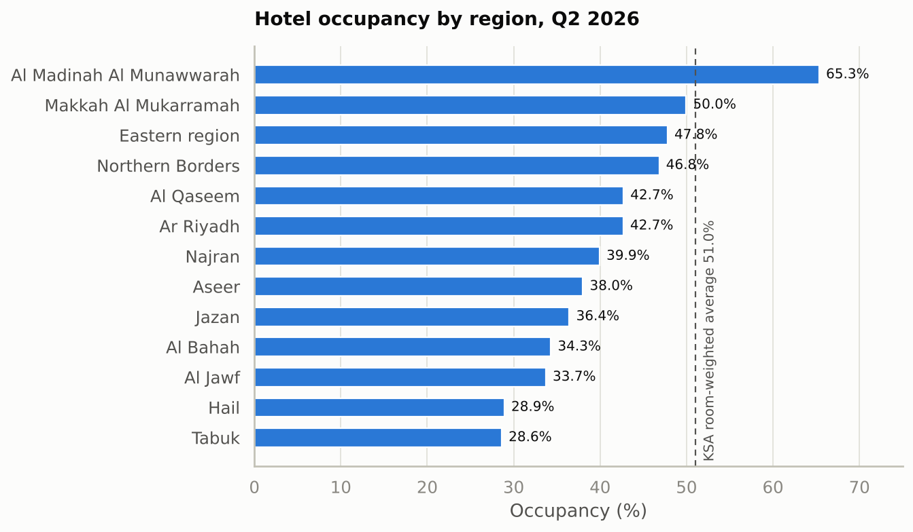
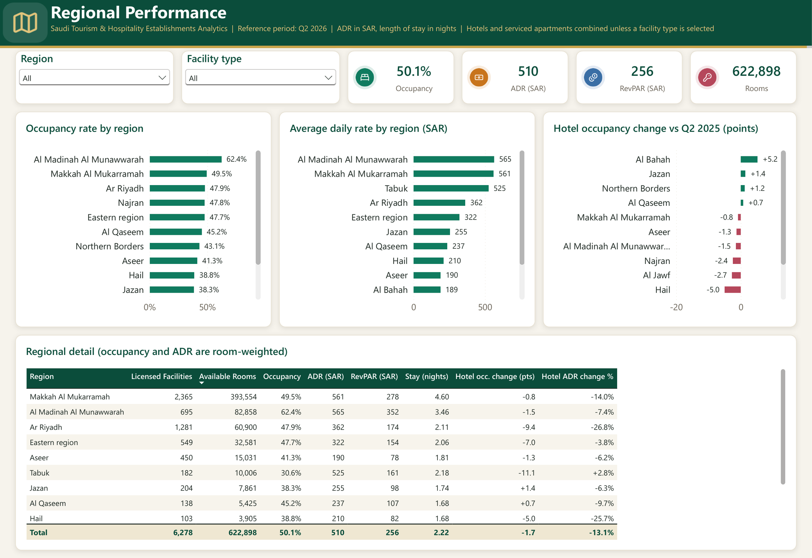
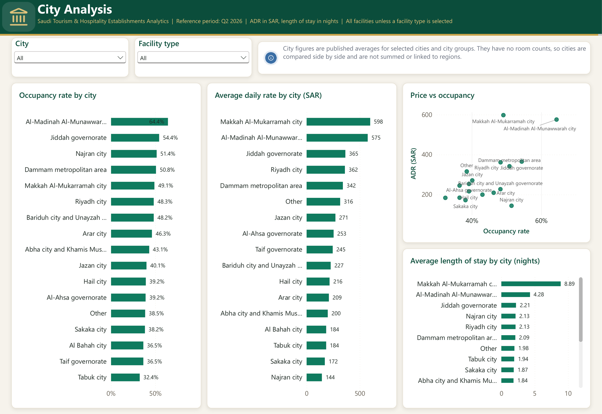
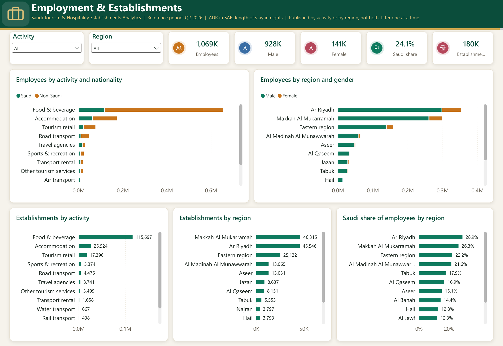
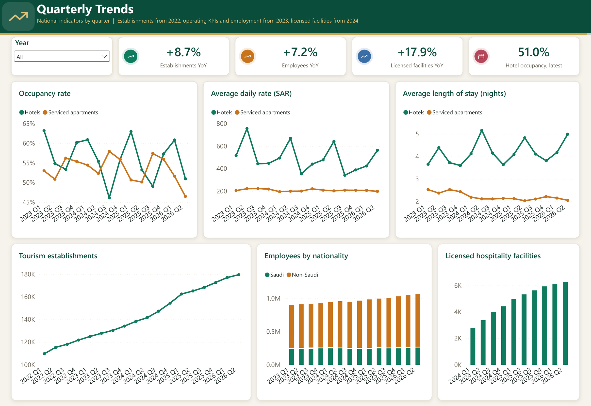

# Saudi Tourism & Hospitality Establishments Analytics – Q2 2026

End-to-end data analysis of Saudi Arabia's tourism and hospitality establishments: occupancy, room prices (ADR), length of stay, geographic distribution, employment and number of establishments. Built with Python, SQL and Power BI.



---

## 1. Project Overview

| Item | Detail |
|---|---|
| Reference period | Q2 2026 (April–June), with a national time series from Q1 2022 |
| Scope | 13 administrative regions, 17 cities / city groups, 12 tourism activities |
| Deliverables | 3 Jupyter notebooks, 12 EDA charts, SQL queries, business insights report, 5-page Power BI dashboard |

**Headline numbers – Q2 2026**

| KPI | Value |
|---|---|
| Tourism establishments | 179,507 |
| Employees in tourism activities | 1,069,120 |
| Licensed hospitality facilities | 6,278 |
| Available rooms | 622,898 |
| Hotel occupancy rate | 51.0% |
| Serviced apartments occupancy rate | 46.5% |
| Hotel average daily rate (ADR) | SAR 563 |
| Hotel average length of stay | 5.0 nights |

## 2. Business Problem

The tourism sector is growing fast, but growth in the number of facilities does not automatically mean better performance. Decision makers need to know:

- Which regions and cities are performing well, and which are underused?
- How do prices and length of stay differ across the country?
- Is new supply being filled by demand?
- How is employment distributed by activity and region, and where is Saudi participation low?
- Which tourism activities make up the market?

## 3. Dataset Description & Source

Source: official Saudi tourism establishments statistics bulletin for Q2 2026, provided as a cleaned Excel workbook (`data/raw/Saudi_Tourism_Analytics_Cleaned.xlsx`). Column prefixes such as `2_3_` match the table numbers of the bulletin.

The workbook contains 7 main analysis tables (plus the original bulletin tables `1_1` to `3_16`):

| Dataset | Rows × Cols | Grain | Content |
|---|---|---|---|
| Quarterly_Trends | 18 × 17 | Quarter (Q1 2022 – Q2 2026) | National KPIs over time |
| Regional_KPIs | 13 × 50 | Region | Facilities, rooms, monthly occupancy / ADR / length of stay, Q2 2025 vs Q2 2026 |
| City_KPIs | 17 × 46 | City | Occupancy, ADR and length of stay by facility type and month |
| Employment_Activity | 12 × 14 | Activity | Employees by nationality and gender |
| Employment_Region | 13 × 13 | Region | Employees by nationality and gender |
| Establishments_Activity | 12 × 4 | Activity | Number and share of establishments |
| Establishments_Region | 13 × 4 | Region | Number and share of establishments |

Full column definitions: [`reports/data_dictionary.csv`](reports/data_dictionary.csv).

**Units:** occupancy and shares are fractions (0–1, shown as %); ADR is SAR per occupied room-night; length of stay is in nights; everything else is a count.

## 4. Tools & Technologies

- **Python** – pandas, NumPy, Matplotlib, Seaborn (Jupyter notebooks in VS Code)
- **SQL** – SQLite, run on the processed tables to cross-check the Python results
- **Power BI Desktop** – star-schema data model, DAX measures, 5-page dashboard
- **Excel** – source workbook

## 5. Data Cleaning

The source file was already cleaned (no duplicate rows, consistent names). The work in [`01_data_understanding.ipynb`](notebooks/01_data_understanding.ipynb) focused on structure:

- Profiled every table: shape, key column, data types, missing values, duplicates. Each table has a unique single-column key and **no duplicates**.
- Missing values exist only in `Quarterly_Trends` and are **structural**: establishments are published from 2022, operating KPIs and employment from 2023, licensed facility counts from 2024.
- Verified the meaning of `Change_rate` columns: occupancy change is a **difference in percentage points**, ADR and length-of-stay change is a **relative % change**.
- Reshaped the wide bulletin layout (one column per month / facility type / gender) into long **fact tables**, each at its own grain, plus shared **dimension tables**. Output in `data/processed/`:

| Type | Tables |
|---|---|
| Dimensions | `Dim_Quarter`, `Dim_Region`, `Dim_City`, `Dim_Activity`, `Dim_Facility_Type` |
| Facts | `Fact_Quarterly`, `Fact_Regional_Hospitality`, `Fact_Regional_Monthly`, `Fact_City_Hospitality`, `Fact_City_Monthly`, `Fact_Employment_Activity`, `Fact_Employment_Region`, `Fact_Establishments_Activity`, `Fact_Establishments_Region` |

## 6. Exploratory Data Analysis

[`02_exploratory_data_analysis.ipynb`](notebooks/02_exploratory_data_analysis.ipynb) covers 8 themes with 12 charts. Every chart is followed by a short business reading computed from the data in the same cell.

| # | Theme | Chart |
|---|---|---|
| 1 | Quarterly trends | [Establishments trend](reports/charts/01_establishments_trend.png) · [Occupancy trend](reports/charts/02_occupancy_trend.png) · [ADR trend](reports/charts/03_adr_trend.png) |
| 2 | Regional analysis | [Hotel occupancy by region](reports/charts/04_hotel_occupancy_by_region.png) · [Year-on-year change](reports/charts/05_hotel_occupancy_yoy.png) |
| 3 | City analysis | [Occupancy by city](reports/charts/06_occupancy_by_city.png) · [ADR vs occupancy](reports/charts/07_city_adr_vs_occupancy.png) |
| 4 | ADR analysis | [ADR by region](reports/charts/08_adr_by_region.png) |
| 5 | Length of stay | [Length of stay by region](reports/charts/09_length_of_stay_by_region.png) |
| 6 | Employment | [Employment by activity](reports/charts/10_employment_by_activity.png) · [Saudization by region](reports/charts/11_saudization_by_region.png) |
| 7 | Establishments | [Establishments by activity](reports/charts/12_establishments_by_activity.png) |



**A key method choice:** regional occupancy and ADR are already averages, so the national figure must be **weighted** (occupancy by available rooms, ADR by rooms sold). A simple average of the 13 regions gives a hotel occupancy of 41.2% instead of the published 51.0%, because Makkah and Madinah hold 86% of hotel rooms.

## 7. SQL Analysis

[`sql/analysis_queries.sql`](sql/analysis_queries.sql) recomputes the main figures with SQL on the processed tables (run in SQLite inside notebook 03):

1. Headline totals – each fact table at its own grain, no joins between facts
2. National occupancy and ADR by facility type (weighted vs simple average)
3. Hotel performance by region with year-on-year change and a RevPAR proxy
4. Establishments and employees by activity, joined through the shared dimension
5. Employment and establishments by region, with Saudi and female shares
6. City ranking by occupancy

## 8. Power BI Dashboard

File: `powerbi/Saudi_Tourism_Dashboard.pbix` (source also saved in Power BI Project format: `Saudi_Tourism_Dashboard.pbip`).

**Data model**

- Star schema: 5 dimension tables and 9 fact tables, each fact table at its own grain.
- Fact tables are linked **only** to their dimensions (Region, City, Activity, Quarter, Facility Type), never to each other, so city, region, employment and establishment numbers are not duplicated.
- 47 DAX measures, documented in [`powerbi/dax_measures.md`](powerbi/dax_measures.md). Occupancy and ADR measures use weighted averages.

**Design**

- Custom theme inspired by Saudi green and gold: deep-green header band with a gold rule, sand page background, white rounded cards with soft shadows.
- KPI cards with icons ([Lucide](https://lucide.dev) icon set, ISC license).
- Chart palette checked for colour-blind safety: green, amber, blue, rose.
- Year-on-year occupancy change is coloured by direction: green for gains, rose for declines.
- Straight trend lines with markers, so values between quarters are not invented by smoothing.
- Slicers: Region and Facility type (pages 2–3), Activity and Region (page 4), Year (page 5).

**Pages**

| Page | Content |
|---|---|
| 1. Executive Overview | Headline KPIs, establishments trend, key findings |
| 2. Regional Performance | Occupancy, ADR and length of stay by region, Q2 2025 vs Q2 2026 |
| 3. City Analysis | City comparison of occupancy, ADR and length of stay |
| 4. Employment & Establishments | Workforce by activity, region, nationality and gender; establishments by activity and region |
| 5. Quarterly Trends | National KPIs over time |

| | |
|---|---|
|  |  |
|  |  |

**Validation:** every core measure was checked against Python ([`reports/measure_validation_python.csv`](reports/measure_validation_python.csv)):

| Measure | Python | Published | Difference |
|---|---|---|---|
| Total Establishments | 179,507 | 179,507 | 0% |
| Total Employees | 1,069,120 | 1,069,120 | 0% |
| Licensed Facilities | 6,278 | 6,278 | 0% |
| Hotel Occupancy (room-weighted) | 51.01% | 50.99% | +0.04% |
| Hotel ADR (weighted by rooms sold) | SAR 573 | SAR 563 | +1.8% |

The same values were checked inside Power BI: with the Facility type slicer set to Hotels, the dashboard shows 51.0% occupancy, SAR 573 ADR and 3,020 hotels; with Activity = Accommodation it shows 172,602 employees, 35.3% Saudi share and 25,924 establishments, all matching Python.

Note: the source publishes employment and establishments **by activity** and **by region** separately, not cross-tabulated. Filtering by activity therefore blanks the region visuals on page 4 (and the reverse) instead of showing wrong numbers.

## 9. Key Findings

Full details (observation, number, explanation, recommendation): [`reports/business_insights.md`](reports/business_insights.md).

1. **Food & beverage dominates** – 64.5% of establishments (115,697) and 61.2% of employees.
2. **Supply is growing faster than demand** – licensed facilities +17.9% year-on-year (5,326 → 6,278), while hotel occupancy fell from 53.2% to 51.0% and serviced apartments from 50.2% to 46.5%, the lowest in 14 quarters.
3. **Occupancy differs by more than 2x between regions** – Al Madinah 65.3% vs Tabuk 28.6%; 9 of 13 regions declined year-on-year.
4. **Riyadh hotels corrected sharply** – ADR SAR 739 → 541 (-26.8%) and occupancy 52.1% → 42.7%.
5. **Hotel prices depend on the Hajj quarter** – Q2 ADR averages SAR 658 vs SAR 432 in other quarters, but each Q2 peak is lower than the last (756 → 669 → 643 → 563).
6. **Prices vary 3.7x across regions** – Tabuk SAR 738 (with 28.6% occupancy) vs Najran SAR 200.
7. **Outside the holy cities, guests stay under two nights** – Makkah hotels 7.3 nights, Madinah 4.3, other regions median 1.8.
8. **Workforce growth is mostly non-Saudi** – employees +7.2% year-on-year (non-Saudi +8.2%, Saudi +4.2%); Saudi share 24.1% overall, 18% in food & beverage.

## 10. Business Recommendations

1. **Fill capacity before adding it** – link new licensing incentives to occupancy, and run demand campaigns for serviced apartments and low-occupancy regions.
2. **Set targets per region**, not from the national average, and prioritise regions below 35% hotel occupancy (Tabuk, Hail, Al Jawf, Al Bahah) with seasonal events and domestic packages.
3. **Investigate Riyadh first** – compare event calendars and new room supply between Q2 2025 and Q2 2026 before changing prices.
4. **Reduce dependence on the Hajj peak** – build shoulder-season demand (Umrah off-peak, Makkah–Madinah–Jeddah itineraries) and do not use Q2 as an annual baseline.
5. **Extend length of stay** outside the holy cities by bundling accommodation with attractions and events.
6. **Target localisation** at food & beverage and at regions with Saudi share below 13%; Saudi women are already 46.6% of Saudi tourism employees, so female-focused programmes have a large reach.
7. **Diversify activities** – cultural and sports & recreation establishments are a very small base and the clearest growth gap.

## 11. Limitations

1. Regional, city, employment and establishment tables cover **one quarter only (Q2 2026)**. The only regional comparison over time is Q2 2025 vs Q2 2026.
2. National series start at different dates (establishments 2022, operating KPIs and employment 2023, licensed facilities 2024), so long-term comparisons are limited.
3. Regional occupancy and ADR are already averages; national values require weighting, and recomputed ADR differs from the published value by about 2%.
4. The city table is **not** a breakdown of the region table (selected cities plus an `Other` group, no room counts), so cities cannot be rolled up to regions.
5. Occupancy, ADR and length of stay cover **accommodation only**; employment and establishments cover all 12 tourism activities.
6. Explanations in the insights are hypotheses: the data shows what changed, not why.

---

## Project Structure

```
Saudi_Tourism_Analytics/
├── data/
│   ├── raw/                  # original Excel workbook
│   └── processed/            # tidy CSVs: dimension and fact tables
├── notebooks/
│   ├── 01_data_understanding.ipynb
│   ├── 02_exploratory_data_analysis.ipynb
│   ├── 03_business_insights.ipynb
│   └── prep_lib.py           # reshaping helpers used by the notebooks
├── sql/
│   └── analysis_queries.sql
├── powerbi/
│   ├── Saudi_Tourism_Dashboard.pbix
│   ├── Saudi_Tourism_Dashboard.pbip   # Power BI Project (text-based source)
│   └── dax_measures.md
├── reports/
│   ├── charts/               # 12 EDA charts
│   ├── screenshots/          # dashboard pages
│   ├── business_insights.md
│   ├── data_dictionary.csv
│   └── measure_validation_python.csv
├── README.md
└── requirements.txt
```

## How to Run

```bash
pip install -r requirements.txt
cd notebooks
jupyter notebook   # or open the notebooks in VS Code
```

Run the notebooks in order (01 → 02 → 03). Notebook 01 writes `data/processed/`, notebook 02 writes `reports/charts/`, notebook 03 writes `reports/business_insights.md` and runs the SQL cross-check. Open `powerbi/Saudi_Tourism_Dashboard.pbix` in Power BI Desktop.

## Author

**Mohamed Salih** – Data Analyst, Riyadh
